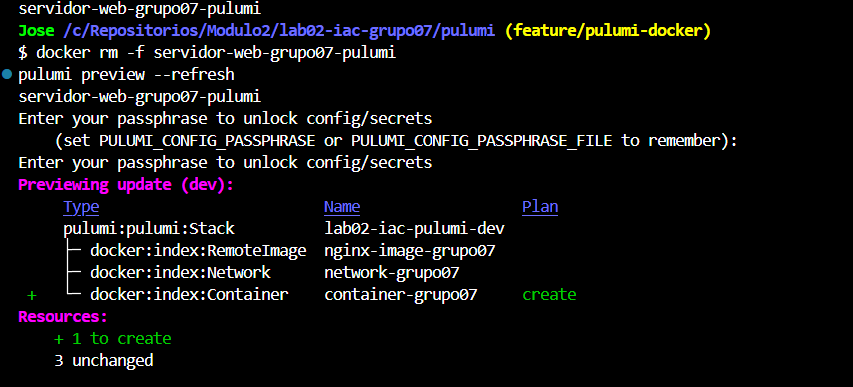
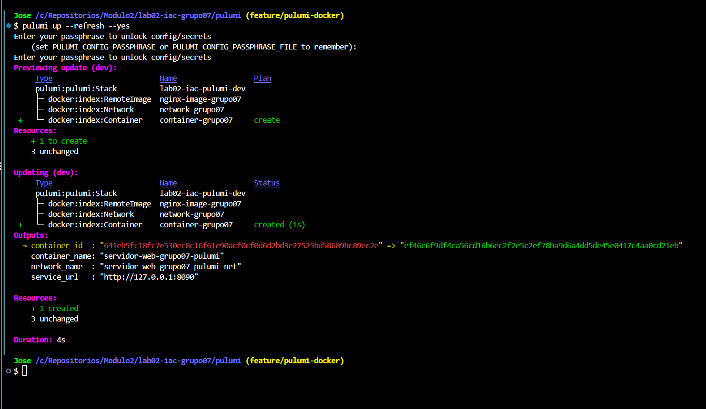

# Informe comparativo

**Grupo**: grupo07

**Integrantes**:
- David Alexander Zambrano B. - R1 (Terraform)
- Jose David Anacona Pira - R2 (Pulumi)
- David Alexander Zambrano B. y Jose David Anacona Pira - R3 (Platform Lead)

## 7.1 Matriz de Comparación Empírica

<table border="1" cellpadding="8" style="border-collapse: collapse; width: 100%;">
  <thead>
    <tr>
      <th style="border: 1px solid;">Criterio de comparación</th>
      <th style="border: 1px solid;">Terraform (HCL)</th>
      <th style="border: 1px solid;">Pulumi (Python)</th>
      <th style="border: 1px solid;">Análisis del Grupo con Evidencia Observada</th>
    </tr>
  </thead>
  <tbody>
    <tr>
      <td style="border: 1px solid;">1. Curva de aprendizaje y sintaxis</td>
      <td style="border: 1px solid;">DSL declarativo especializado</td>
      <td style="border: 1px solid;">Lenguaje general orientado a objetos</td>
      <td style="border: 1px solid;">Socializando en equipo se concluyo que la configuración en terraform fue mas rapida, ya que usa HCL para definir la insfraestructura y terraform init para instalar el proveedor necesario. En el caso de pulumi se requirieron varios pasos adicionales, entre los que estan preparar el entorno virtual de Python, instalar dependencias y crear el stack con su contraseña, mientras que en Terraform todas sus configuraciones se encuentran en los archivos y no se requieren pasos adicionales. </td>
    </tr>
    <tr>
      <td style="border: 1px solid;">2. Líneas de código efectivas (LOC)</td>
      <td style="border: 1px solid;">104 líneas</td>
      <td style="border: 1px solid;">70 líneas</td>
      <td style="border: 1px solid;">Luego del conteo se evidenció que Pulumi necesitó 34 lineas menos que Terraform. Esto se debe a que Python permite expresar los recursos y outputs de forma mas compacta, mientras que HCL requirió más bloques para variables, validaciones y salidas. Además, Pulimi necesitó configuraciones adicionales realizadas durante su preparación mientras que tefarrom ya los define dentro de sus archivos.</td>
    </tr>
    <tr>
      <td style="border: 1px solid;">3. Manejo del Estado (State)</td>
      <td style="border: 1px solid;">Archivo <code>terraform.tfstate</code></td>
      <td style="border: 1px solid;">Metadatos de Stack local en <code>~/.pulumi</code></td>
      <td style="border: 1px solid;">Ambos estados permitieron la identificación del contenedor, la imagen, la red, y sus dependencias. Terraform resultó mas directo para inspeccionarlo manualmente, ya que en el principio tiene los outputs y referencias cortas entre recursos. Para el caso de Pulumi, este separa inputs y outputs, pero contiene más metadatos e identificadores largos, lo que hace más compleja su inspección manual.</td>
    </tr>
    <tr>
      <td style="border: 1px solid;">4. Validación de variables y tipos</td>
      <td style="border: 1px solid;">Bloque <code>validation { condition = ... }</code></td>
      <td style="border: 1px solid;">Lógica en Python (<code>if ... raise ValueError</code>)</td>
      <td style="border: 1px solid;">Se realizó una prueba de error en ambos casos, y los dos detectaron el error antes del despliegue. Terraform lo detectó durante el plan, y Pulumi durante el preview. Con respecto a la claridad de la información, Terraform mostró un mensaje más claro y directo, indicando la variable inválida y los valores permitidos, mientras que Pulumi mostró esa misma información acompañada de un traceback de Python, que requiere mayor analisis para detectar la causa y ubicación del error.</td>
    </tr>
    <tr>
      <td style="border: 1px solid;">5. Detección y corrección de Drift</td>
      <td style="border: 1px solid;"><code>terraform plan</code></td>
      <td style="border: 1px solid;"><code>pulumi preview --refresh</code></td>
      <td style="border: 1px solid;">Luego de realizar la prueba del Drift definida en la guía, se encontró que Terraform consulta el estado real automáticamente al ejecutar plan sin agregarle ningun otro parámtero, mientras que en Pulumi usamos preview --refresh para forzar esa consulta. Durante la prueba, ambos detectaron el contenedor elimiado y propusieron recrearlo sin hacer cambios en los demas recursos. </td>
    </tr>
    <tr>
      <td style="border: 1px solid;">6. Multiplicidad y ciclos</td>
      <td style="border: 1px solid;">Meta-argumento <code>count</code> / <code>for_each</code></td>
      <td style="border: 1px solid;">Bucle estándar <code>for</code> en listas Python</td>
      <td style="border: 1px solid;">Realizando el análisis, para crear 10 replicas resulta más familiar y fácil de leer el bucle for de Python, ya que es una sintáxis mas conocida y general, mientras que en el caso de Terraform, aunque se puede realizar con count o for_each, primero hay que familiarizarse con su uso y sintáxis, y es algo más específico del lenguaje. </td>
    </tr>
    <tr>
      <td style="border: 1px solid;">7. Ecosistema de Linters / Shift-Left</td>
      <td style="border: 1px solid;"><code>terraform fmt</code>, <code>terraform validate</code></td>
      <td style="border: 1px solid;"><code>ruff</code>, <code>flake8</code></td>
      <td style="border: 1px solid;">Luego de configurar el pipeline respectivo y ejecutarlo en cada uno de los Pull Request, se evidenció que en el caso de Terraform la ejecución tardo 8 segundos, mientras que en el caso de Pulumi se tardo 9 segundos. Esto es debido a que sólamente se estan haciendo análisis estaticos del código, y no se están ejecutando ni desplegando nada adicional.</td>
    </tr>
  </tbody>
</table>

## 7.2 Evidencias del Experimento de Drift
### Pulumi

Eliminamos manualmente el contenedor con
`docker rm -f servidor-web-grupo07-pulumi` y ejecutamos
`pulumi preview --refresh`.

Pulumi detectó que faltaba el contenedor y propuso recrearlo:
1 recurso por crear y 3 sin cambios.

Después ejecutamos `pulumi up --refresh --yes`.
El contenedor se recreó con un nuevo ID, sin modificar la red
ni la imagen. La operación tardó 4 segundos.

## 7.3 Conclusión Arquitectónica
(Responder en 2 párrafos: Si tuvieran que desplegar una arquitectura de microservicios en una empresa donde todos los desarrolladores son de Python pero no saben DevOps, ¿cuál herramienta elegirían y qué precauciones tomarían?)
